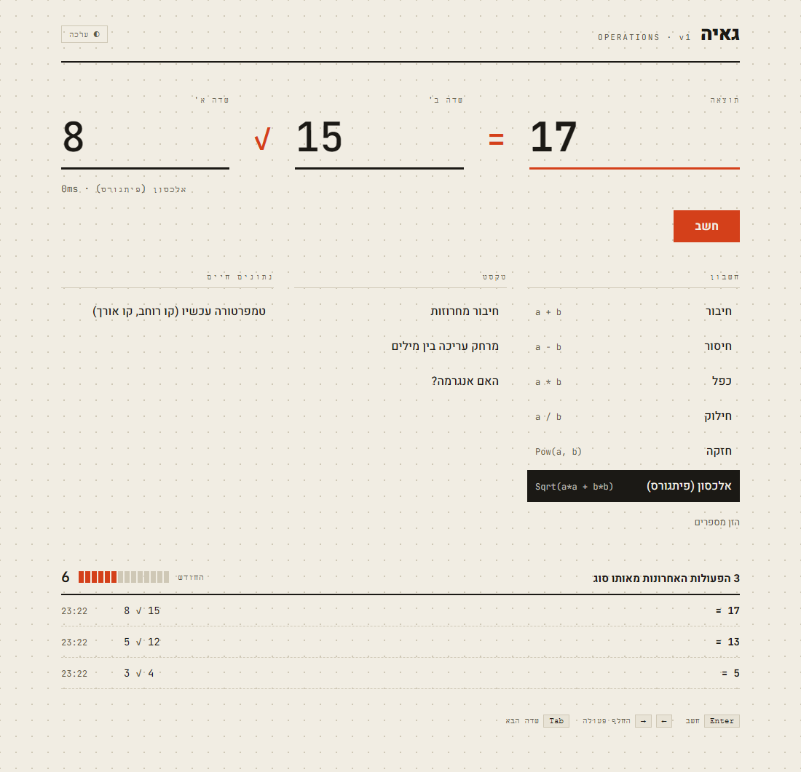
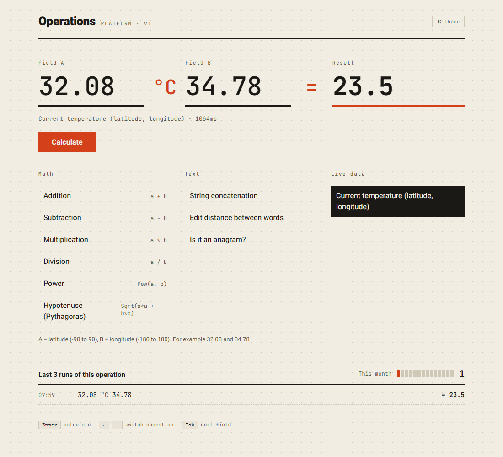
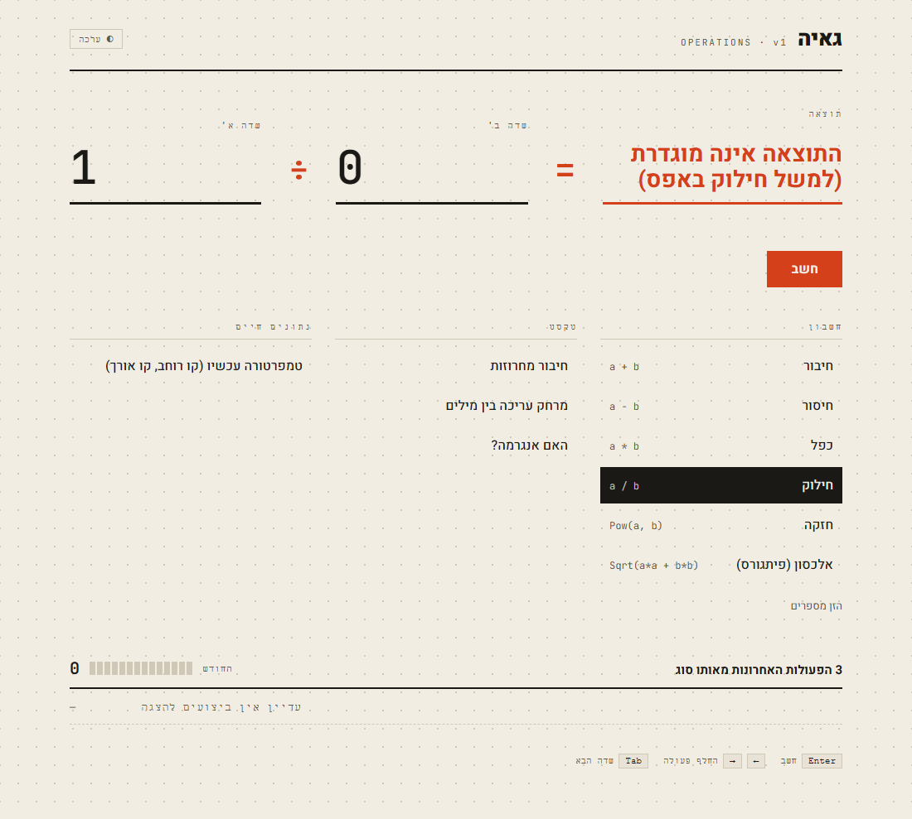

<div align="center">

# Operations Platform

**A platform that runs operations on two inputs (field A and field B). New operations are added through the API, with no new development.**

`.NET 10` · `C#` · `SQL Server` · `EF Core` · `Angular` · `Serilog`

[Demo](#demo) · [Run it](#run-it) · [API](#api) · [Add an operation](#add-an-operation-without-coding) · [Design decisions](#design-decisions) · [Logs](#logs) · [Security](#security-and-limits)

</div>

## Demo

[](docs/demo.webm)

A slow walkthrough of the screen, recorded against the real API and SQL Server: [`docs/demo.webm`](docs/demo.webm).
It runs all ten operations, an error (`1 / 0`), keyboard use (arrow keys switch the operation, Enter calculates) and the dark theme.

| Result and history | Weather | Error |
|:---:|:---:|:---:|
|  |  |  |

## What is in the exercise

| Requirement | Where it is |
|---|---|
| Operations on field A and field B | 10 operations: arithmetic, strings, and the current temperature for a latitude and a longitude |
| Add, change and remove operations without development | `POST` / `PUT` / `DELETE /api/operations`: a formula, a text function, or a call to an external API |
| API for outside applications | `GET /api/operations` and `POST /api/calculate` |
| User interface | Angular: field A, an operation, field B, **Calculate**, the result |
| History in a database | Every calculation is saved in `OperationLogs`, including failed ones |
| The last 3 runs of the same operation and the count since the start of the month | Returned with every calculation. The month starts at midnight Israel time |
| A log of system errors | `logs/errors-*.log` |
| A log of all requests and responses | `logs/http-*.log` |

## Run it

Requirements: **.NET SDK 10**, **Node 22**, and **SQL Server Express** with an instance named `SQLEXPRESS` (or any SQL Server, see below).

```bash
cd frontend
npm install
npm run build          # builds the UI into backend/OperationsPlatform.Web/wwwroot

cd ../backend/OperationsPlatform.Web
dotnet run
```

On the first start the application creates the database `OperationsPlatformDb` by itself from its EF Core migration and inserts the ten starting operations. The address is printed in the console (`http://localhost:5177`). The UI is served at `/`, and the API documentation at `/swagger`.

- **Another SQL Server:** change `ConnectionStrings:Default` in `appsettings.json`, or set the environment variable `ConnectionStrings__Default`.
- **UI with live reload:** `npx ng serve` in `frontend` (port 4200, proxies `/api` to `http://localhost:5177`).
- **Changing operations needs an admin key.** Reading and calculating are open. For development:
  ```bash
  dotnet user-secrets set "Admin:Key" "<a long random key>" -p backend/OperationsPlatform.Web
  ```
  In production, set the environment variable `Admin__Key`. With no key configured, every change is refused.

## API

| Method | Path | Description |
|---|---|---|
| `GET` | `/api/operations` | The active operations |
| `POST` | `/api/calculate` | `{ "a": "3", "b": "4", "operation": "hypotenuse" }` returns the result, the last 3 runs of that operation and the count since the start of the month |
| `POST` `PUT` `DELETE` | `/api/operations` | Add, change and remove an operation (needs the header `X-Admin-Key`) |

| Status | When |
|:---:|---|
| `400` | Invalid input, a broken formula, a character that is not allowed |
| `401` | The admin key is missing or wrong |
| `404` / `409` | The operation does not exist / the operation key is already used |
| `413` | A request body larger than 64 KB |
| `502` | An external service failed or timed out |
| `500` | An unexpected failure. It is written to `errors-*.log` |

"The start of the month" is midnight of the 1st **in Israel time** (`Asia/Jerusalem`), on every server. The clock is set in one class, `IsraelTimeProvider`, and the start of the month is converted to UTC for the database query.

## Add an operation without coding

Define a new operation with `POST /api/operations`. There are three kinds:

| Kind | What it is | Example |
|---|---|---|
| **Expression** | A formula on `a` and `b`, evaluated by NCalc: a math interpreter that cannot run code | `a * b + 10` |
| **Text** | A built-in text function | `concat`, `reverse`, `levenshtein`, `anagram` |
| **Http** | A call to an external API from a template | the weather operation, below |

```json
{"url":"https://api.open-meteo.com/v1/forecast?latitude={a}&longitude={b}&current=temperature_2m","path":"current.temperature_2m"}
```

A completely new kind needs one class that implements `IOperationExecutor` and one registration line in `CoreServiceExtensions.cs`.

## Structure

Four layers: `Web → Core → Domain`, and `Common`, which all of them use.

| Layer | Role |
|---|---|
| `Web` | Controllers, middlewares, error handling, Kestrel and logging setup |
| `Core` | Services (each in its own folder with its interface), validators, the executors that run each kind of operation, data access with EF Core, and the repository interfaces in `Abstractions/` |
| `Domain` | The entities and enums |
| `Common` | Shared constants and exceptions |
| `frontend` | The Angular UI. Its build is written into the `wwwroot` of `Web` |

A new migration, from `backend/`:

```bash
dotnet ef migrations add <Name> -p OperationsPlatform.Core -s OperationsPlatform.Web -o Migrations
```

## Design decisions

| Decision | Why |
|---|---|
| **Operations live in the database** | The exercise asks for adding, changing and removing operations without development. An operation is a row: a key, a kind, and a definition. |
| **NCalc for formulas** | A safe interpreter for math. A formula can call `Sqrt`, `Pow`, `Max` and so on, but it cannot reach files, the network or the runtime. |
| **Http operations are limited** | Only hosts listed in `AllowedHttpHosts`, only `https`, no redirects. The server cannot be pointed at internal addresses. The check runs when the operation is saved and again on every call. |
| **Errors are mapped in one place** | `GlobalExceptionHandler` (the built-in `IExceptionHandler`) turns each exception into a status code. The code has no `try/catch` except in `InputValidationMiddleware`. |
| **Failed runs are saved with `try/finally`** | `CalculationService` writes the history row in a `finally` block, with `Succeeded = false` when the operation threw, and the exception then continues to the handler. No `catch` is needed. |
| **History counts only successes** | "The last 3 runs" and the monthly count read rows with `Succeeded = true`. Failed attempts are kept for audit. |
| **One index for both history queries** | `(OperationId, CreatedAtUtc)` serves the latest-3 query and the count since the start of the month. |
| **One allow-list regex for input** | `InputValidationMiddleware` checks every string in a JSON body (names and values, at any depth). Anything outside letters, digits, punctuation and a few symbols gets a plain 400. The reason goes to the log, not to the client. |
| **Soft delete** | `DELETE` sets `IsActive = false`, so the history of an operation is never lost. The database refuses to delete an operation that has history (`Restrict`). |
| **Built-in ASP.NET features first** | `IExceptionHandler`, `ProblemDetails`, `HttpLogging`, Kestrel limits and user-secrets, instead of custom code. |
| **Serilog configured in `appsettings.json`** | Sinks, levels and the filter of each file are configuration, not code. |

## Logs

In the `logs/` folder, rolled daily. The setup is the `Serilog` section in `appsettings.json`: sinks, levels and the filter of each file.

| File | Content |
|---|---|
| `errors-YYYYMMDD.log` | Server failures: 500 and 502 (unexpected exceptions and failing external services), with the stack trace. Mistakes by the caller (400, 404, 409) are not written here. |
| `http-YYYYMMDD.log` | Every request and response (body, status and duration), and a `[WRN]` line for each request rejected because of a character that is not allowed. |

Every line carries the request id (`RequestId`), so a line in `errors-*.log` can be matched to its request in `http-*.log`.

## History

Every calculation that reached its operation is saved in `OperationLogs` (input, result, duration, time and `Succeeded`), also when it failed: invalid input for the operation, a division by zero, an external service that was down.

- A validation error or an unknown operation is not saved, because there is no operation to attach it to.
- "The last 3 runs" and the monthly count include only the calculations that succeeded.

## Security and limits

- **Admin key.** `POST` / `PUT` / `DELETE` under `/api/operations`, and `GET /api/operations?includeInactive=true`, need the header `X-Admin-Key` to match `Admin:Key`. There is **no default key**: it is empty in `appsettings.json`, so every change is refused until one is configured. Calculating and reading the active operations are open.
- **External calls.** Http operations can reach only hosts in `AllowedHttpHosts` (default `api.open-meteo.com`), only over `https`, without redirects.
- **Request size.** A body larger than 64 KB gets 413. This is Kestrel's `MaxRequestBodySize`, so the request never reaches the application code.
- **Input.** `InputValidationMiddleware` checks the body of every `POST` / `PUT` under `/api` before the controller. Every string in the JSON must match **one regex** (a constant inside the middleware): letters of any language (Hebrew included), digits, punctuation, space, tab and new line, and the symbols `+ = ^ | ~ $ °`. Everything else is refused, including `<` and `>` (so no HTML tag), control characters, text-direction overrides and emoji.

  A caller who sends a forbidden character gets a plain **400 with no explanation**. The field is written to `http-*.log`:

  ```
  Rejected POST /api/calculate: field 'body.a' has characters that are not allowed
  ```

  The field rules (length, format) are checked by FluentValidation inside the services, and its messages are returned per field: `{"errors":{"key":["..."],"name":["..."]}}`.

**Known limits, on purpose:**

- A formula cannot use `<` or `>`. Use `Max`, `Min`, `Sign` and `Abs` instead.
- The text `javascript:` passes. It is harmless until someone puts it in a link, and the platform does not.
- The business checks (a duplicate key, a formula that does not work, a host that is not allowed) stay in the services, because they need the database or the operation engine.
- There is no rate limit, so the admin key can be guessed. Use a long random key (32 characters or more) and do not expose the server to the internet without protection in front of it.
- SQL injection is not scanned for here: every query goes through EF Core with parameters, and that is the real protection.

## Using AI

The exercise allowed the use of AI. The code was written with Claude (Anthropic) and reviewed, and the authors take responsibility for understanding and explaining every part of it.
